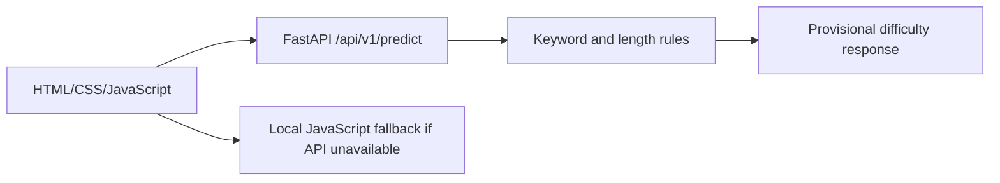
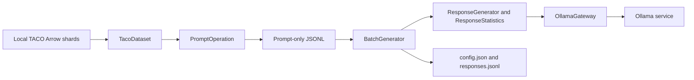

# Current architecture

The implementation has two independent workflows. The application currently
predicts with heuristics; the modeling workflow generates responses through Ollama.
Neither executes generated solutions.

## Application workflow

- `backend/main.py` creates the application, configures CORS and includes routes.
  It mounts `frontend/` when that directory exists.
- `backend/api/schemas.py` defines `PredictionRequest`, `PredictionResponse` and
  `PredictionDetails`.
- `backend/api/endpoints.py` provides health and provisional prediction routes.
- `frontend/js/main.js` handles requests, examples, result rendering and fallback.

The API exposes fixed heuristic confidence/success-rate values. It does not
measure LLM success, invoke Ollama, use dataset IDs or load model weights.

## Modeling workflow

| Component | Actual responsibility |
|---|---|
| `TacoDataset` | Pin/download the dataset and read Arrow batches, rows or questions. |
| `DatasetManager` | Resolve data paths and load candidate indices. |
| `PromptOperation` | Validate, deduplicate and atomically export prompt text. |
| `TacoIntegrityAuditor` | Structural data audit; does not run reference solutions. |
| `CandidateSelector` | Produce filtered candidate rows from metadata and flags. |
| `GenerationConfig` | Model, endpoint, options and inference settings. |
| `ResponseGenerator` | Generate a response and collect experiment metadata. |
| `ResponseStatistics` | Provider timings, token counts and throughput. |
| `HardwareMonitor` | Optional NVIDIA/NVML hardware sampling. |
| `BatchGenerator` | Validate prompts, assign content IDs, manage attempts/resume and persist JSONL. |
| `OllamaGateway` | Provider call with no experiment persistence. |

Modeling imports the shared gateway from `inference/`, not the application
backend. The notebooks orchestrate existing classes rather than define another
provider or statistics implementation.

## Storage and boundaries

Raw data stays under `modeling/data/raw/`. Prompt exports are under
`modeling/data/processed/`; experimental run files are under
`modeling/experiments/runs/<run_id>/`. There is no database.

The candidate-selection pipeline is separate from the main prompt export.
The current main notebook reads all TACO questions instead of selecting candidate
rows. Response IDs link to a content hash, not to a persisted dataset record key.
See [traceability verification](../data/02_prompt_traceability.md).

There is no sandbox, neural model, training pipeline or deployed model service
in the checked-out implementation. Saved generation statistics are not code
correctness results.

## Existing drawings

The files in `images/` and `diagram/` are retained design sketches from an earlier
planning stage. They contain proposed training, sandbox and deployment paths;
they are not evidence those components exist. The two flows above describe the
current implementation and supersede those sketches for implementation status.
